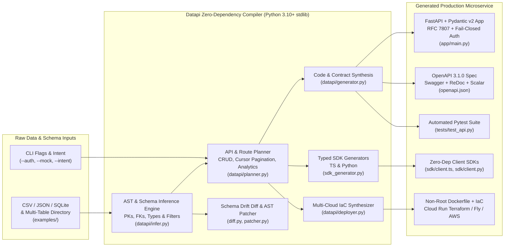

<div align="center">


### Raw data in. Production APIs out.

**Turn raw schemas and legacy data into tested, containerized, production-ready APIs in seconds.**

[](https://github.com/creova-gif/api-gen/actions/workflows/ci.yml)
[](https://www.python.org/)
[](https://fastapi.tiangolo.com)
[](https://spec.openapis.org/oas/v3.1.0)
[](https://www.terraform.io/)
[](LICENSE)

<p align="center">
  <a href="#-quickstart">Quickstart</a> •
  <a href="#️-system-architecture">Architecture</a> •
  <a href="#-implementation-status">Status</a> •
  <a href="#-engineering-decisions">Engineering Decisions</a> •
  <a href="#-cli-reference">CLI Reference</a> •
  <a href="#-contributing">Contributing</a>
</p>

</div>

---

> **CLI Identity (`datapi` / `apigen`):** This repository (`creova-gif/api-gen`) ships the **Datapi** schema-to-API compiler package. Installing the package exposes both the primary **`datapi`** CLI and the backwards-compatible **`apigen`** alias (`datapi.py` / `apigen.py`), so existing scripts and CI pipelines continue to work unchanged.

## 📌 The Problem

Forward-Deployed Engineers, Solutions Architects, and backend developers spend days or weeks during customer onboarding manually writing boilerplate to expose legacy customer exports (CSV, JSON, SQLite database dumps) as typed internal or partner services.

Existing "database-to-API" tools (Hasura, PostgREST) often stall in enterprise security reviews because platform teams **reject opaque black-box proxy layers** in front of data sources. Engineers need clean, typed, inspectable, and git-committable source code that passes standard CI/CD, static analysis, and container security gates.

**Datapi (`datapi` / `apigen`) solves this.** In well under a second, `datapi` inspects raw datasets and compiles a complete, tested, containerized FastAPI microservice repository with OpenAPI 3.1 contracts, typed TypeScript/Python SDKs, and multi-cloud deployment bundles.

---

## 🏗️ System Architecture



---

## 📊 Implementation Status

| Subsystem | Status | Notes |
| :--- | :--- | :--- |
| **Schema Inference Engine (`datapi/infer.py`)** | `Implemented & Verified` | Infers `int`, `float`, `bool`, `date`, `datetime`, `uuid`, `email`, `str`, primary keys, filter candidates, and multi-table foreign keys across CSV, JSON, and SQLite |
| **FastAPI + OpenAPI 3.1 Generator (`datapi/generator.py`)** | `Implemented & Verified` | Emits Pydantic v2 models, CRUD endpoints, cursor pagination, RFC 7807 errors, `/healthz`, Scalar/Swagger/ReDoc UI, and non-root `Dockerfile` |
| **Fail-Closed Auth & Cloud Run Terraform** | `Implemented & Verified` | Optional `--auth` guard (`X-API-Key` + `503` fail-closed when `API_KEY` unset) and Cloud Run v2 + Secret Manager Terraform |
| **Typed Client SDKs (`sdk_generator.py`, `python_sdk_generator.py`)** | `Implemented & Verified` | Generates zero-dependency TypeScript (`sdk/client.ts`) and Python (`sdk/client.py`) clients with exponential backoff retries |
| **Schema Drift Diff & Consumer AST Patcher (`diff.py`, `patcher.py`)** | `Implemented & Verified` | Detects breaking/non-breaking schema drift, emits PR markdown, and patches consumer `.py`/`.ts`/`.tsx` files |
| **Multi-Cloud Deployer (`datapi/deployer.py`)** | `Implemented & Verified` | Emits deployment bundles for Google Cloud Run, Fly.io (`fly.toml`), and AWS App Runner (`apprunner.yaml`) |
| **DuckDB / SQLite Analytics Engine (`datapi/analytics.py`)** | `Implemented & Verified` | Generates analytical aggregation routes with SQLite stdlib execution and optional DuckDB acceleration |
| **Datapi Studio Web UI (`datapi/studio/`)** | `Implemented & Verified` | Local zero-dependency browser UI (`datapi studio`) for drag-and-drop schema inspection, live code preview, and ZIP export |

---

## 🧠 Engineering Decisions

Detailed architectural trade-offs are recorded in [ADR 0001: Deterministic Code Generation over Runtime Proxy Reflection & Zero-Dependency Compiler Core](docs/adr/0001-deterministic-codegen-and-zero-dep-core.md).

1. **Zero Runtime Dependencies for the Compiler Core:**
   - `datapi` itself depends exclusively on the Python 3.10+ standard library (`dependencies = []` in `pyproject.toml`).
   - **Why:** Eliminates dependency conflicts when installing `datapi` into existing repositories or CI runners, guarantees offline execution, and keeps third-party web framework dependencies (`fastapi`, `pydantic`, `uvicorn`) scoped strictly to the generated target microservice.
2. **Deterministic Code Generation vs. Runtime Reflection:**
   - Rather than running a runtime reflection proxy in front of a database, `datapi` compiles static, human-readable Python and TypeScript files.
   - **Why:** Generated code can be committed to Git, reviewed in pull requests, linted with Ruff/Mypy, tested with `pytest`, and customized by application engineers without fighting a black-box middleware layer.
3. **OpenAPI 3.1.0 Contract-First Output & Automated Contract Verification:**
   - Every `datapi generate` invocation emits both a strict `openapi.json` (OpenAPI 3.1.0) specification and an executable `tests/test_api.py` suite covering health probes, CRUD lifecycle, pagination, and authentication boundaries.
   - **Why:** Ensures the API contract, server implementation, client SDKs, and test suite can never drift out of sync at generation time.
4. **Fail-Closed Security & Non-Root Containers by Default:**
   - Services generated with `--auth` return `HTTP 503` if `API_KEY` is missing from the environment rather than failing open, and every generated `Dockerfile` runs as an unprivileged user (`id -u != 0`), verified in CI on every push. See [SECURITY.md](SECURITY.md).

---

## ✨ Key Features

- **Schema inference** from CSV, JSON and SQLite: types (`int`, `float`, `bool`, `date`, `datetime`, `uuid`, `email`, `str`), primary keys, foreign keys, and filter candidates.
- **FastAPI + Pydantic v2 service** with full CRUD, cursor pagination, free-text search, RFC 7807 error envelopes, and `/healthz`.
- **OpenAPI 3.1 contract**, Swagger, ReDoc and Scalar docs.
- **Typed SDKs**: zero-dependency TypeScript client (`sdk/client.ts`) and Python client (`sdk/client.py`).
- **Generated pytest contract suite** for every service (`tests/test_api.py`).
- **Optional `X-API-Key` auth** that fails closed until `API_KEY` is set.
- **Deployment bundles** for Google Cloud Run (Terraform), Fly.io and AWS App Runner.
- **Schema drift detection** (`datapi diff`) and consumer code patching (`datapi patch`).
- **datapi Studio**, a local browser UI for drag-and-drop generation.
- **Zero runtime dependencies** for the generator itself (standard library only).

<p align="center"></p>

---

## ✅ Prerequisites

- Python **3.10+** (CI verifies 3.10–3.13)
- `pip`
- To run a generated service: the packages in its `requirements.txt` (FastAPI, Uvicorn, Pydantic v2)
- Optional: Docker, Terraform 1.5+ and the `gcloud` CLI for deployment

---

## ⚡ Quickstart

### 1. Installation

The core generator has **zero third-party dependencies**:

```bash
git clone https://github.com/creova-gif/api-gen.git
cd api-gen
pip install -e .
```

Both `datapi` and `apigen` CLI commands are now available on your `PATH`.

### 2. Inspect Inferred Schema (Terminal)

Inspect any dataset without touching a database:

```bash
python3 datapi.py inspect -d examples/customers.csv
```

**Output:**
```text
✨ Inferred Schema for: customer (Plural: customers)
Primary Key: customer_id

Field                Python Type    OpenAPI Type   Nullable   Filter Candidate
---------------------------------------------------------------------------
customer_id (PK)     int            integer        False      True
full_name            str            string         False      False
email                str            string         False      False
plan_tier            str            string         False      False
account_balance      float          number         False      False
is_active            bool           boolean        False      False
created_at           datetime       string         False      False

Sample records ingested: 5
```

### 3. Generate Full API Repository

Generate an authenticated FastAPI microservice with 25 synthetic mock records and Cloud Run Terraform:

```bash
python3 datapi.py generate \
  -d examples/customers.csv \
  -o ./my_customer_api \
  --auth \
  --mock 25
```

### 4. Run the Generated API

```bash
cd my_customer_api
pip install -r requirements-dev.txt
pytest tests/
export API_KEY="$(python3 -c 'import secrets; print(secrets.token_urlsafe(32))')"  # required with --auth
uvicorn app.main:app --port 8080 --reload
```

With `--auth`, the service fails closed: resource endpoints return `503` until `API_KEY` is set, and `401` for a missing or wrong `X-API-Key`. The Terraform module takes the key as a sensitive `api_key` variable (`terraform apply -var="api_key=..."`).

- **Interactive Swagger UI**: `http://localhost:8080/docs`
- **Interactive Scalar UI**: `http://localhost:8080/scalar`
- **ReDoc Technical Docs**: `http://localhost:8080/redoc`
- **Health Liveness Probe**: `http://localhost:8080/healthz`

---

## 🔍 Why datapi vs. Alternatives?

| Feature | datapi (`apigen`) | Hasura / PostgREST | Supabase / PocketBase | Manual Coding |
| :--- | :---: | :---: | :---: | :---: |
| **Output Type** | **Git-Committable Code** | Black-box Proxy | Proprietary BaaS | Custom Code |
| **Data Ingestion** | **Raw CSV, JSON, SQLite** | Requires Live Postgres | DB Migration Required | Manual Mapping |
| **Vendor Lock-In** | **None (Standard Python)** | High | High | None |
| **Enterprise Auditable** | **100% Inspectable** | ❌ Opaque Proxy | ❌ Proprietary Cloud | ✅ Custom |
| **Time to Live API** | **< 5 seconds** | 10–30 minutes | 15–45 minutes | 2–3 weeks |
| **Turnkey Cloud Run IaC** | **Included (Terraform)** | ❌ No | ❌ No | ❌ Manual |
| **Automated Test Suite** | **Included (Pytest)** | ❌ No | ❌ No | ❌ Manual |

---

## 📦 Generated Project Structure

Every generated microservice is a clean, self-contained repository:

```text
my_customer_api/
├── README.md               # Quickstart and endpoint documentation
├── requirements.txt        # Runtime dependencies (FastAPI, Uvicorn, Pydantic v2)
├── requirements-dev.txt    # Test dependencies (pytest, httpx)
├── Dockerfile              # Non-root Python 3.12-slim container
├── openapi.json            # Strict OpenAPI 3.1.0 contract
├── app/
│   ├── __init__.py
│   └── main.py             # FastAPI service, Pydantic v2 models, Scalar docs & auth
├── sdk/
│   ├── client.ts           # Zero-dependency typed TypeScript Client SDK
│   └── client.py           # Zero-dependency typed Python Client SDK
├── tests/
│   ├── __init__.py
│   └── test_api.py         # Automated contract tests (health, CRUD, pagination, auth)
└── terraform/
    └── main.tf             # Google Cloud Run v2 service + Secret Manager IAM policy
```

---

## 🛠️ CLI Reference

```text
usage: datapi [-h] {inspect,generate,diff,patch,studio,deploy} ...
```

### `datapi studio` *(Interactive Web UI)*
Launches the zero-setup, dark-mode datapi Studio in your browser:
```bash
python3 datapi.py studio            # binds 127.0.0.1:3000
python3 datapi.py studio --host 0.0.0.0 --port 8000 --no-open
```
- Drag-and-drop CSV, JSON, or SQLite datasets.
- Interactive in-browser live testing sandbox.
- Live syntax-highlighted previews of FastAPI, TypeScript SDK, and Terraform.
- 1-Click ZIP bundle export.

### `datapi inspect`
Inspects data source and prints detected column types, primary keys, and filter candidates.

| Flag | Shorthand | Required | Description |
| :--- | :---: | :---: | :--- |
| `--data` | `-d` | Yes | Path to source file (`.csv`, `.json`, `.sqlite`, `.db`) or directory |
| `--name` | `-n` | No | Override inferred resource name |

### `datapi generate`
Generates complete OpenAPI spec, FastAPI app, Pytest suite, TypeScript/Python SDKs, and Terraform scripts.

| Flag | Shorthand | Default | Description |
| :--- | :---: | :---: | :--- |
| `--data` | `-d` | *Required* | Path to input data file or multi-table directory |
| `--out` | `-o` | `./generated_<name>_api` | Destination output directory |
| `--name` | `-n` | Inferred | Override resource singular name |
| `--auth` | | `False` | Enable `X-API-Key` auth wired to Cloud Secret Manager |
| `--mock` | | `0` | Synthesize N schema-valid mock records |
| `--intent` | `-i` | `None` | Natural language guidance (e.g. `"read-only"`) |

### `datapi diff` *(Self-Maintaining APIs)*
Detects breaking vs. non-breaking schema drift between datasets and outputs automated GitHub PR bodies.

| Flag | Shorthand | Default | Description |
| :--- | :---: | :---: | :--- |
| `--old` | `-a` | *Required* | Path to base data source |
| `--new` | `-b` | *Required* | Path to updated data source |
| `--name` | `-n` | Inferred | Override resource name |
| `--pr` | `-p` | None | Save markdown PR body for automated GitHub pull requests |

### `datapi patch`
Rewrites consumer code (`.ts`, `.tsx`, `.py`) when a schema changes. Shows a dry-run diff unless `--apply` is passed.

| Flag | Shorthand | Default | Description |
| :--- | :---: | :---: | :--- |
| `--consumer-dir` | | `.` | Directory containing the consumer codebase (alias `--target-dir`) |
| `--diff` | `-f` | None | Path to a schema diff JSON file |
| `--old` / `--new` | `-a` / `-b` | None | Data files to diff (alternative to `--diff`) |
| `--name` | `-n` | Inferred | Override resource name |
| `--apply` | | `False` | Write patches in place |

### `datapi deploy`
Generates deployment bundles for Cloud Run, Fly.io, and AWS App Runner.

| Flag | Shorthand | Default | Description |
| :--- | :---: | :---: | :--- |
| `--target` | `-t` | `all` | `cloudrun`, `fly`, `aws` or `all` |
| `--out` | `-o` | `./deploy` | Output directory |
| `--data` | `-d` | None | Optional input data file |
| `--name` | `-n` | Inferred | Override service name |
| `--auth` | | `False` | Enable API key auth in the configs |
| `--dry-run` | | `False` | Print configs to stdout without writing files |

---

## ⚙️ Configuration

datapi is configured through CLI flags (see above). Generated services read:

| Variable | Used by | Description |
| :--- | :--- | :--- |
| `API_KEY` | Services generated with `--auth` | Expected `X-API-Key` value. Endpoints return `503` until it is set. |
| `api_key` (Terraform variable) | `terraform/main.tf` | Sensitive variable stored in Secret Manager and mounted into Cloud Run. |

A composite GitHub Action for CI lives in [`.github/actions/datapi-action`](.github/actions/datapi-action/action.yml); see [`docs/GITHUB_ACTION.md`](docs/GITHUB_ACTION.md).

---

## 🗂️ Repository Structure

```text
api-gen/
├── datapi/                # Generator package
│   ├── cli.py             # CLI entry point (inspect, generate, diff, patch, studio, deploy)
│   ├── infer.py           # Schema & foreign-key inference for CSV / JSON / SQLite
│   ├── planner.py         # Builds the API plan from schema + intent
│   ├── generator.py       # FastAPI app, OpenAPI 3.1 spec, tests, Dockerfile, Terraform
│   ├── sdk_generator.py   # TypeScript SDK generator
│   ├── python_sdk_generator.py # Python SDK generator
│   ├── diff.py            # Schema drift detection
│   ├── patcher.py         # AST/token consumer code patcher
│   ├── deployer.py        # Cloud Run / Fly.io / AWS App Runner bundles
│   ├── analytics.py       # DuckDB / SQLite analytical query helpers
│   └── studio/            # Local interactive browser Studio UI
├── datapi.py, apigen.py   # Run-from-source wrappers (datapi + backwards-compatible apigen)
├── bin/                   # Shell launchers (bin/datapi, bin/apigen)
├── examples/              # Sample datasets (customers.csv, orders.csv, products.csv, inventory.json)
├── tests/                 # 7-suite unit & E2E integration test suite
└── docs/                  # Architecture ADRs, security policy, brand kit, and GitHub Action docs
```

---

## 🎨 Brand & Design System

The official brand guidelines, design tokens, and vector assets are detailed in:
- [`docs/BRAND_KIT.md`](docs/BRAND_KIT.md)
- [`docs/brand-kit.html`](docs/brand-kit.html) (Interactive Brand Presentation)

---

## 🧪 Testing datapi

Run the test suite across schema inference, code generation, SDK resilience, AST patching, multi-cloud deployment, and E2E FastAPI contract validation:

```bash
pip install -e ".[test]"
python3 -m unittest discover -s tests -v
```

---

## 🤝 Contributing

Contributions are welcome. Read [`CONTRIBUTING.md`](CONTRIBUTING.md) for setup and PR guidelines, and follow our [Code of Conduct](CODE_OF_CONDUCT.md). Security vulnerabilities should be reported per [`SECURITY.md`](SECURITY.md). Release notes are in [`CHANGELOG.md`](CHANGELOG.md).

---

## 📄 License

Distributed under the **MIT License**. See [`LICENSE`](LICENSE) for details.

---

## 💬 Support

- Bugs and feature requests: [open an issue](https://github.com/creova-gif/api-gen/issues)
- Security issues: see [`SECURITY.md`](SECURITY.md) or email creativeinnovationspace@gmail.com
- Maintainer: Justin Mafie ([@creova-gif](https://github.com/creova-gif))
