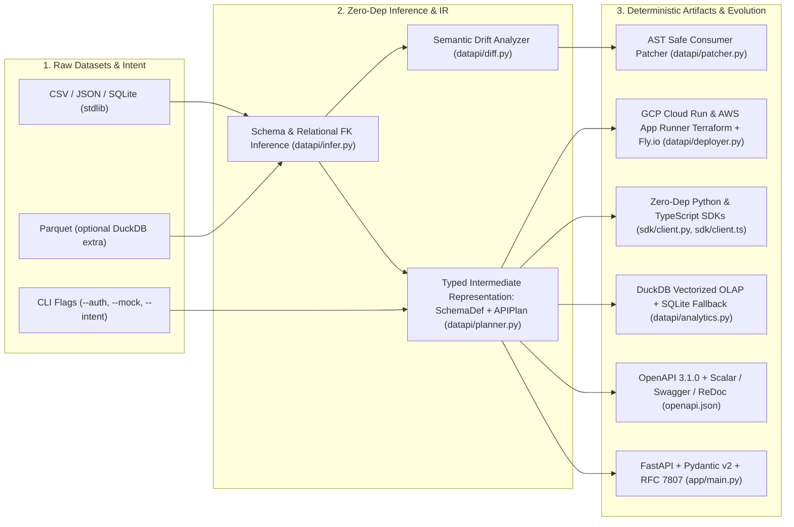

<div align="center">


### Raw data in. Production APIs out.

**Deterministic zero-dependency Python compiler that turns raw datasets into tested FastAPI services, OpenAPI 3.1 contracts, typed Python/TypeScript SDKs, DuckDB analytics, and secret-hardened GCP/AWS Terraform.**

[](https://github.com/creova-gif/api-gen/actions/workflows/ci.yml)
[](https://www.python.org/)
[](https://fastapi.tiangolo.com)
[](https://spec.openapis.org/oas/v3.1.0)
[](https://www.terraform.io/)
[](LICENSE)

<p align="center">
  <a href="#-quickstart">Quickstart</a> •
  <a href="#️-dataset-to-service-compilation-pipeline">Architecture</a> •
  <a href="#-implementation-status">Status</a> •
  <a href="#-engineering-decisions--trade-offs">Engineering Decisions</a> •
  <a href="#-cli-reference">CLI Reference</a> •
  <a href="#️-roadmap--known-limitations">Roadmap</a>
</p>

</div>

---

> **CLI Identity (`datapi` / `apigen`):** This repository (`creova-gif/api-gen`) ships the **Datapi** (`v0.2.0`) schema-to-API compiler package. Installing the package exposes both the primary **`datapi`** CLI and the backwards-compatible **`apigen`** alias (`datapi.py` / `apigen.py`), so existing scripts and CI pipelines continue to work unchanged.

## 📌 Problem Statement & Operational Context

Forward-deployed engineers, solutions architects, and backend teams routinely spend days writing repetitive glue code to expose legacy flat-file exports (`.csv`, `.json`, `.sqlite`, `.parquet`, or multi-table directory dumps) as typed, authenticated internal or partner APIs.

Existing "database-to-API" proxies (Hasura, PostgREST) frequently stall in enterprise security reviews because platform teams **reject opaque runtime proxies** in front of data stores: proxy layers cannot be diffed in pull requests, linted with standard static analyzers, or extended with custom Python business logic without escaping the proxy.

**Datapi solves this as a deterministic source-to-source compiler.** Using only the Python 3.10+ standard library for its core engine, `datapi` inspects raw datasets and emits a complete, human-auditable, git-committable FastAPI microservice repository—complete with OpenAPI 3.1.0 specs, vectorized DuckDB/SQLite analytics, zero-dependency Python & TypeScript SDKs, executable `pytest` contract suites, AST-guided consumer migration patches, and secret-hardened GCP Cloud Run / AWS App Runner / Fly.io deployment manifests.

---

## 🏗️ Dataset-to-Service Compilation Pipeline



---

## 📊 Implementation Status

| Subsystem | Status | Implementation & Verification Notes |
| :--- | :--- | :--- |
| **Zero-Dep Schema & FK Inference (`datapi/infer.py`)** | `Implemented & Verified` | Pure Python 3.10+ stdlib ingestion for `.csv`, `.json`, `.sqlite`/`.db`, and multi-table directories; detects `int`, `float`, `Decimal`, `bool`, `date`, `datetime`, `email`, `uuid`, enums, PKs, and cross-table FKs |
| **Parquet & DuckDB OLAP (`datapi[analytics]`)** | `Implemented (Optional Extra)` | Optional `duckdb>=1.0.0` extra enables native `.parquet` ingestion (`read_parquet(?)`). Generated `/analytics/summary` & `/analytics/timeseries` endpoints use DuckDB when `duckdb` is installed in the service environment and fall back automatically to stdlib `sqlite3` window functions by default |
| **FastAPI + OpenAPI 3.1 Synthesizer (`datapi/generator.py`)** | `Implemented & Verified` | Emits Pydantic v2 models, CRUD routes, keyset cursor + offset pagination, `Idempotency-Key` replay cache, RFC 7807 `application/problem+json` errors, `/healthz`, Scalar/Swagger/ReDoc UI, and non-root `Dockerfile` |
| **Fail-Closed Auth & Strict CORS** | `Implemented & Verified` | `--auth` enforces constant-time `hmac.compare_digest` over `X-API-Key` across CRUD and `/analytics/*` routes, returning `503` if `API_KEY` is unset; `CORS_ALLOW_ORIGINS` never combines `*` with `allow_credentials=True` |
| **Typed Python & TypeScript SDKs (`sdk_generator.py`, `python_sdk_generator.py`)** | `Implemented & Verified` | Zero-dependency `sdk/client.ts` (`fetch`) and `sdk/client.py` (`urllib.request`) with cursor helpers, timeouts, exponential backoff retries (`HTTP 429` & `503`), and RFC 7807 error classes |
| **Schema Drift Diff & AST Consumer Patcher (`diff.py`, `patcher.py`)** | `Implemented & Verified` | Classifies breaking vs. non-breaking drift, generates PR markdown, and rewrites `.py`/`.ts`/`.tsx` consumers with dry-run unified diffs and `ast.parse()` syntax gates |
| **Multi-Cloud IaC Deployer (`datapi/deployer.py`)** | `Implemented & Verified` | Emits Google Cloud Run v2 (`terraform/main.tf`), AWS App Runner (`terraform/aws_apprunner.tf`), and Fly.io (`fly.toml`) manifests with `sensitive = true` secret variables wired to GCP Secret Manager and AWS Secrets Manager |
| **Datapi Studio Browser UI (`datapi/studio/`)** | `Implemented & Verified` | Local stdlib HTTP server (`datapi studio`, bound to `127.0.0.1` by default) with browser-side schema inspection, request simulator, live code previews, and ZIP export |
| **Live Postgres/MySQL Introspection & Hosted GitHub App** | `Planned` |Tracked on the roadmap below; not claimed as shipped in `v0.2.0` |

---

## 🧠 Engineering Decisions & Trade-Offs

Architectural decisions are formally recorded in [ADR 0001: Deterministic Code Generation over Runtime Proxy Reflection & Zero-Dependency Compiler Core](docs/adr/0001-deterministic-codegen-and-zero-dep-core.md).

### 1. Zero-Dependency Stdlib Schema Inference vs. Heavy Data Frameworks
- **Decision:** Keep core `dependencies = []` in [`pyproject.toml`](pyproject.toml), implementing type lattice resolution, primary/foreign-key discovery, OpenAPI 3.1 synthesis, SDK emission, and AST patching entirely with the Python 3.10+ standard library (`csv`, `json`, `sqlite3`, `ast`, `urllib`, `http.server`). Isolate `duckdb` strictly to the optional `datapi[analytics]` extra with automatic `sqlite3` window-function fallback.
- **Trade-Off:** Implementing custom regex/value-lattice type inference (`datapi/infer.py`) requires more upfront parser code than importing Pandas or SQLAlchemy, and `.parquet` ingestion requires installing `datapi[analytics]`. In return, `datapi` installs in milliseconds inside restricted CI runners or air-gapped environments with zero transitive version conflicts, and keeps web runtime dependencies (`fastapi`, `pydantic`, `uvicorn`) scoped strictly to the generated target service.

### 2. AST-Guided Consumer Patching vs. Destructive Overwrites
- **Decision:** Separate clean artifact emission (`datapi generate` into a dedicated service directory) from downstream schema evolution (`datapi diff` + `datapi patch`). When a dataset schema changes, `datapi patch` computes dry-run unified diffs (`diff -u`) across consumer `.py`, `.ts`, `.tsx`, `.js`, and `.jsx` files, rewrites renamed attributes/keys, converts removed fields into non-throwing fallbacks (`.get(..., None)` / `getattr(..., None)`), and validates every modified Python file via `ast.parse()` in memory before touching disk (`--apply`).
- **Trade-Off:** Blindly overwriting hand-edited consumer codebases destroys custom business logic, whereas full cross-language semantic refactoring requires heavy compiler toolchains (`tsserver`/LSP). AST-validated Python patching + targeted TypeScript token rewriting hits the pragmatic sweet spot: zero external dependencies, deterministic dry-run reviewability, and guaranteed syntax validity before write.

### 3. End-to-End Generated Service Verification in CI
- **Decision:** A code generator is only as trustworthy as the code it emits. Rather than stopping at snapshot string assertions, [`.github/workflows/ci.yml`](.github/workflows/ci.yml) runs a 4-job verification pipeline (`lint`, `test` across Python 3.10–3.13, `package`, and `docker`) on every push and pull request:
  1. Executes 68 unit & integration tests validating `ast.parse()` syntax, multi-table FK graphs, DuckDB/SQLite analytics parity, SDK retry backoff, and Terraform secret hygiene.
  2. Runs `datapi generate` on CSV and JSON datasets, provisions fresh virtualenvs, installs generated `requirements-dev.txt`, and **runs the generated `pytest` contract suites** against live `TestClient` apps.
  3. Builds a wheel, installs it into `/tmp/wheel-venv`, and smoke-tests the `datapi` CLI outside the repository tree.
  4. Builds the generated `Dockerfile`, boots the container with `API_KEY=ci-key`, and verifies `/healthz`, `200` authenticated access, `401` unauthenticated rejection, and non-root execution (`id -u != 0`).

### 4. Fail-Closed Security & Secret-Manager Terraform Parity
- **Decision:** Generated `--auth` services fail closed (`HTTP 503` if `API_KEY` is unset; constant-time `hmac.compare_digest` check; `401` RFC 7807 Problem Details on invalid keys), enforce safe `CORS_ALLOW_ORIGINS` defaults (never pairing `allow_origins=["*"]` with `allow_credentials=True`), validate analytics `group_by`/`date_field`/`metric` parameters against inferred column allowlists, and emit `sensitive = true` Terraform `api_key` variables **with no default values** wired to **Google Cloud Secret Manager** (`terraform/main.tf`) and **AWS Secrets Manager** (`terraform/aws_apprunner.tf`). See [`SECURITY.md`](SECURITY.md).

---

## 🛠️ Technology Stack

| Layer | Technology | Scope |
| :--- | :--- | :--- |
| **Compiler Core** | Python 3.10–3.13 Standard Library (`csv`, `json`, `sqlite3`, `ast`, `http.server`) | `datapi` CLI (`dependencies = []`) |
| **Columnar / Parquet Extra** | DuckDB `>=1.0.0` (with stdlib SQLite window-function fallback) | Optional `pip install "datapi[analytics]"` |
| **Generated Service Runtime** | FastAPI `>=0.110`, Pydantic v2 `>=2.7`, Uvicorn `>=0.29`, OpenAPI `3.1.0` | Emitted into target `requirements.txt` |
| **Generated Client SDKs** | TypeScript (`fetch` + `AbortSignal`) & Python (`urllib.request`) | Emitted into `sdk/client.ts` & `sdk/client.py` |
| **Generated Infrastructure** | Docker (`python:3.12-slim` non-root), Terraform `>=1.5` (GCP Cloud Run v2, AWS App Runner), Fly.io | Emitted by `generate` and `deploy` |

---

## ⚡ Quickstart

### Prerequisites
- Python **3.10+** (verified on 3.10, 3.11, 3.12, and 3.13)
- Optional: `pip install -e ".[analytics]"` for `.parquet` ingestion and DuckDB OLAP acceleration
- Optional: Docker and Terraform `1.5+` to build/deploy generated containers

### 1. Install `datapi`

```bash
git clone https://github.com/creova-gif/api-gen.git
cd api-gen
pip install -e .
```

Both `datapi` and `apigen` CLI entrypoints are now on your `PATH`.

### 2. Inspect a Raw Dataset

```bash
datapi inspect -d examples/customers.csv
```

```text
✨ Inferred Schema for: customer (Plural: customers)
Primary Key: customer_id

Field                Python Type    OpenAPI Type   Nullable   Filter Candidate
---------------------------------------------------------------------------
customer_id (PK)     int            integer        False      True
full_name            str            string         False      False
email                str            string         False      False
plan_tier            str            string         False      False
account_balance      float          number         False      False
is_active            bool           boolean        False      False
created_at           datetime       string         False      False

Sample records ingested: 5
```

### 3. Compile a Complete Production Service

```bash
datapi generate \
  -d examples/customers.csv \
  -o ./my_customer_api \
  --auth \
  --mock 25
```

### 4. Test & Boot the Generated Service

```bash
cd my_customer_api
pip install -r requirements-dev.txt
pytest tests/
export API_KEY="$(python3 -c 'import secrets; print(secrets.token_urlsafe(32))')"
uvicorn app.main:app --port 8080 --reload
```

- **Swagger UI:** `http://localhost:8080/docs`
- **Scalar Reference UI:** `http://localhost:8080/scalar`
- **ReDoc Reference:** `http://localhost:8080/redoc`
- **Health Probe:** `http://localhost:8080/healthz`
- **Vectorized Analytics:** `curl -H "X-API-Key: $API_KEY" "http://localhost:8080/customers/analytics/summary?group_by=plan_tier"`

---

## 📦 Generated Service Layout

```text
my_customer_api/
├── README.md               # Service quickstart & cURL examples
├── requirements.txt        # Runtime dependencies (FastAPI, Uvicorn, Pydantic v2)
├── requirements-dev.txt    # Contract test dependencies (pytest, httpx)
├── Dockerfile              # Non-root Python 3.12-slim container (UID 10001)
├── openapi.json            # Strict OpenAPI 3.1.0 specification
├── app/
│   ├── __init__.py
│   └── main.py             # FastAPI CRUD, RFC 7807 handlers, fail-closed auth & analytics routes
├── sdk/
│   ├── client.ts           # Zero-dependency typed TypeScript SDK (retries + timeout)
│   └── client.py           # Zero-dependency typed Python SDK (retries + RFC 7807 errors)
├── tests/
│   ├── __init__.py
│   └── test_api.py         # Automated contract test suite (health, CRUD, 404, 401 auth)
└── terraform/
    └── main.tf             # Google Cloud Run v2 + Secret Manager IAM policy
```

Running `datapi deploy --target all --auth -o ./my_customer_api` additionally emits `fly.toml` and `terraform/aws_apprunner.tf` (wired to AWS Secrets Manager).

---

## 🛠️ CLI Reference

```text
usage: datapi [-h] {inspect,generate,diff,patch,studio,deploy} ...
```

| Command | Purpose | Key Flags |
| :--- | :--- | :--- |
| `datapi inspect` | Print inferred field types, nullability, PKs, and filter candidates | `-d/--data <file>`, `-n/--name <resource>` |
| `datapi generate` | Emit FastAPI app, OpenAPI 3.1, Pytest suite, Py/TS SDKs, Dockerfile & Cloud Run Terraform | `-d/--data`, `-o/--out`, `--auth`, `--mock <N>`, `-i/--intent "read-only"` |
| `datapi diff` | Detect breaking vs. non-breaking schema drift and emit automated PR markdown | `-a/--old`, `-b/--new`, `-p/--pr <pr_body.md>` |
| `datapi patch` | Dry-run (or `--apply`) AST/token migrations across consumer `.py`/`.ts`/`.tsx` files | `--consumer-dir`, `-a/--old`, `-b/--new` (or `-f/--diff`), `--apply` |
| `datapi deploy` | Emit multi-cloud IaC bundles (`cloudrun`, `fly`, `aws`, or `all`) | `-t/--target`, `-o/--out`, `-d/--data`, `--auth`, `--dry-run` |
| `datapi studio` | Launch local interactive browser Studio (`127.0.0.1:3000` by default) | `-p/--port`, `--host`, `--no-open` |

A composite GitHub Action for continuous schema-drift gating lives in [`.github/actions/datapi-action/action.yml`](.github/actions/datapi-action/action.yml); see [`docs/GITHUB_ACTION.md`](docs/GITHUB_ACTION.md).

---

## ⚙️ Runtime Configuration & Security

Generated services are configured via environment variables (no `.env` secrets are ever committed or baked into images):

| Variable | Scope | Default & Behavior |
| :--- | :--- | :--- |
| `API_KEY` | FastAPI runtime (`--auth`) | **Required at runtime when `--auth` is enabled.** Endpoints fail closed with `HTTP 503` if unset, and return `401` on invalid `X-API-Key`. |
| `CORS_ALLOW_ORIGINS` | FastAPI runtime | Optional comma-separated origin allowlist (e.g., `https://app.example.com`). Defaults to uncredentialed `*` (`allow_credentials=False`). |
| `PORT` | Container runtime | Defaults to `8080` in `Dockerfile` (Cloud Run) and `8000` in Fly.io / AWS App Runner configs. |
| `TF_VAR_api_key` (`var.api_key`) | GCP & AWS Terraform (`--auth`) | `sensitive = true` with **no default value**; stored in Google Cloud Secret Manager (`main.tf`) or AWS Secrets Manager (`aws_apprunner.tf`). |

Read [`SECURITY.md`](SECURITY.md) for the full threat model covering authentication, CORS, SQL identifier allowlisting, AST patcher safety, and vulnerability disclosure.

---

## 🧪 Local Development & Verification

```bash
# 1. Install test (and optional DuckDB/Parquet analytics) extras + Ruff linter
pip install -e ".[test,analytics]"
pip install ruff

# 2. Run Ruff static checks & bytecode compilation
ruff check --select E9,F datapi datapi.py apigen.py tests
python3 -m compileall -q datapi datapi.py apigen.py tests

# 3. Run the full 68-test unit & E2E integration suite
python3 -m unittest discover -s tests -v
```

---

## 🗺️ Roadmap & Known Limitations

### Implemented (`v0.2.0`)
- [x] Zero-dependency CSV, JSON, and SQLite schema inference (`int`, `float`, `Decimal`, `bool`, `date`, `datetime`, `email`, `uuid`, enums, PKs)
- [x] Multi-table directory scanning & cross-table foreign-key resolution (`infer_from_directory`)
- [x] Optional `.parquet` ingestion & embedded DuckDB vectorized analytics (`datapi[analytics]`) with stdlib SQLite window-function fallback
- [x] OpenAPI 3.1.0 + FastAPI + Pydantic v2 + RFC 7807 Problem Details + cursor pagination + `Idempotency-Key` caching
- [x] Zero-dependency TypeScript (`sdk/client.ts`) and Python (`sdk/client.py`) client SDKs with exponential backoff retries
- [x] Semantic schema drift analyzer (`datapi diff`) & AST-validated consumer code patcher (`datapi patch`)
- [x] Secret-hardened Google Cloud Run (`terraform/main.tf`), AWS App Runner (`terraform/aws_apprunner.tf`), and Fly.io (`fly.toml`) deployment bundles
- [x] Local interactive browser Studio (`datapi studio`)

### Known Limitations & Planned Next
- [ ] **Persistent OLTP Storage Adapter in Generated App:** Generated `app/main.py` currently seeds an in-memory dictionary from dataset records (suitable for read-heavy internal data APIs, mocks, and stateless containers); pluggable SQLite WAL / PostgreSQL `asyncpg` persistence for stateful CRUD writes is planned.
- [ ] **Live Database URI Introspection:** Direct PostgreSQL / MySQL catalog introspection (`datapi generate --db-uri postgresql://...`) without intermediate dump files.
- [ ] **Incremental Server Regeneration:** `datapi patch` updates downstream consumer code via AST/token diffs, whereas re-running `datapi generate` regenerates `app/main.py` from scratch; custom business routes should be mounted via separate FastAPI `APIRouter` modules.
- [ ] **Hosted GitHub App Drift Bot:** Automated webhook-driven pull requests across downstream repositories when upstream data schemas change.

---

## 🤝 Contributing & License

Contributions are welcome! Please read [`CONTRIBUTING.md`](CONTRIBUTING.md), [`AGENTS.md`](AGENTS.md), and our [`CODE_OF_CONDUCT.md`](CODE_OF_CONDUCT.md) before opening a pull request. Release history is tracked in [`CHANGELOG.md`](CHANGELOG.md).

Distributed under the **MIT License** — see [`LICENSE`](LICENSE) for details.
